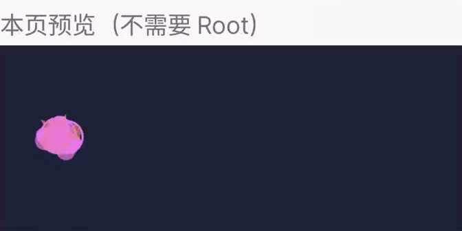

# 魔法手指 · Magic Finger

Android 全局触摸粒子特效实验项目：**设置 APK + Root 模块**。APK 负责设置和普通悬浮窗绘制，Root 后端被动监听触摸，通过本地 socket 转发坐标。

> **实验软件，不保证兼容所有设备。** 当前普通悬浮窗不能覆盖部分系统界面。高层光环探针虽然能显示在通知面板和最近任务之上，但用户确认它会阻挡下层点击、滑动，**不可作为可用方案运行或常驻部署**。

## 效果演示



实机录制，展示设置页预览区的随机效果（星星、爱心、光点、光环）。仅保留预览区域，不含状态栏、通知或其他应用内容；这是本页预览演示，**不代表已解决通知面板、最近任务的覆盖问题，也不展示高层探针**。

[查看 MP4 视频](docs/media/preview-demo.mp4)

## 功能列表

- 总开关及无需 Root 的本页预览。
- 星星、爱心、光点、光环、随机五种效果。
- 调节粒子密度、大小和消散时间。
- 独立前台绘制服务及 Root 后端重连、息屏停止监听。
- KernelSU、Magisk、APatch 分别打包，共用同一 APK。

所有图形自行绘制，不包含旧 ROM 的代码或素材。不依赖 Xposed / LSPosed，不替换系统框架，不修改 SELinux。

## 当前验证情况

| 项目 | 状态 |
| --- | --- |
| Android 16 / API 36、Flyme 移植 ROM、KernelSU | 已进行目标设备测试，不代表其他 ROM 兼容 |
| 普通应用中的全局效果 | 用户确认有效，普通点击滑动此前正常 |
| 通知面板、最近任务 | 普通悬浮窗覆盖不完整，尚未解决 |
| 高层 Surface 光环探针 | 显示成功，但阻挡触摸，验收失败；未整合到正常服务入口 |
| Magisk / APatch | 打包及结构检查通过，未实机验证 |
| 旋转、多屏、多用户、长期功耗与保活 | 未完成验证 |

详细实验经过与验证边界见 [MODULE.md](MODULE.md)。仓库包含未部署的实验源码，不等同于手机正在运行的已安装版本。

## 安装与使用

需要 Root 和悬浮窗权限。安装脚本要求 Android 14+，**仅实测 Android 16**，不代表其他版本已兼容。

1. 安装配套 APK，打开“魔法手指”。
2. 授予悬浮窗权限，开启总开关；可先在本页预览调整参数。
3. 按实际 Root 框架选择一个模块 ZIP，通过对应管理器安装。
4. 重启后测试普通应用中的效果。

| 框架 | 构建产物 |
| --- | --- |
| KernelSU | `magic-finger-kernelsu-0.2-beta.zip` |
| Magisk | `magic-finger-magisk-0.2-beta.zip` |
| APatch | `magic-finger-apatch-0.2-beta.zip` |

三种包的模块 ID 均为 `magic_finger`，同一设备只选一种。模块不会自动安装 APK，APK 无需单独授予 su。Magisk 通过管理器安装，APatch 包属于 APModule；不承诺 Recovery 安装。

关闭效果可使用 APK 总开关。**停用或卸载模块后请重启**；卸载 APK 前建议先关闭效果。如果实验版本影响操作，应停止使用并停用模块，不要运行高层探针。

## 源码构建

当前为轻量 Java / Android SDK 命令行项目，不使用 Gradle。

需要：JDK 8、Android SDK Platform 34、Build Tools 34.0.0、Python 3，以及可运行 D8 / apksigner 的 Java 环境。`build.sh` 中 SDK、JDK 和 keytool 路径为开发机路径，其他电脑需先调整。

```bash
sh build.sh
python3 package_module.py --target kernelsu
python3 package_module.py --target magisk
python3 package_module.py --target apatch
```

输出位于 `dist/`，APK 名称为 `magic-finger-experimental.apk`。构建会检查 APK 签名、模块脚本语法及 ZIP 完整性。

首次构建会在 `build/debug.keystore` 生成本地测试签名。**请妥善保留密钥；不同签名的 APK 不能直接覆盖安装。** 仓库不提交私钥、构建缓存或二进制产物。

## 目录

```text
src/
  ParticleActivity.java   设置和预览
  ParticleService.java    前台普通悬浮窗绘制服务
  MagicFinger.java        粒子绘制及历史窗口实验
  TouchRelay.java         Root 被动输入监听与本地转发
  LayerProbe.java         已知阻挡触摸的隔离探针，勿作为正常入口
  InputProbe.java         输入能力检查探针
stubs/                   仅编译使用的隐藏 API 声明，不打入 DEX
module/                  共用模块配置与启动脚本
magisk/                  Magisk 安装入口
build.sh                 APK / DEX 构建
package_module.py        三种框架模块打包
```

## 隐私与安全边界

- APK 不申请联网权限；运行时不保存触摸坐标或轨迹。
- Root 后端与 APK 通过本地 socket 通信，并检查对端 UID。
- 输入监听不调用 `pilferPointers`，不主动注入触摸事件；这不代表所有实验实现都已通过触摸透传验收。
- UID 校验不是抵抗恶意 Root 的安全边界。Root 模块仅应从可信来源安装。
- 固定 user 0，未支持 Android 多用户。其他应用或系统可隐藏普通悬浮窗。

## Releases

[v0.2-beta](https://github.com/1042004021/magic_finger/releases/tag/v0.2-beta) 提供 `magic-finger-0.2-beta.apk`、三种 Root 模块 ZIP 和 `SHA256SUMS` 校验文件。Beta 的 APK / 模块版本均为 0.2-beta，versionCode=3，APK 沿用开发机原测试签名。完成构建、验签和包结构检查，尚未完成本版实机回归。高层探针没有接入正常服务入口。

发布附件副本位于 `release-assets/v0.2-beta/`，不包含签名私钥；常规构建仍输出至已忽略的 `dist/`。GitHub 自动生成的 Source code ZIP 不能作为 Root 模块刷入。旧 v0.2-experimental 仅发布源码。不要将 Beta 视为完整兼容性或长期稳定性承诺。
